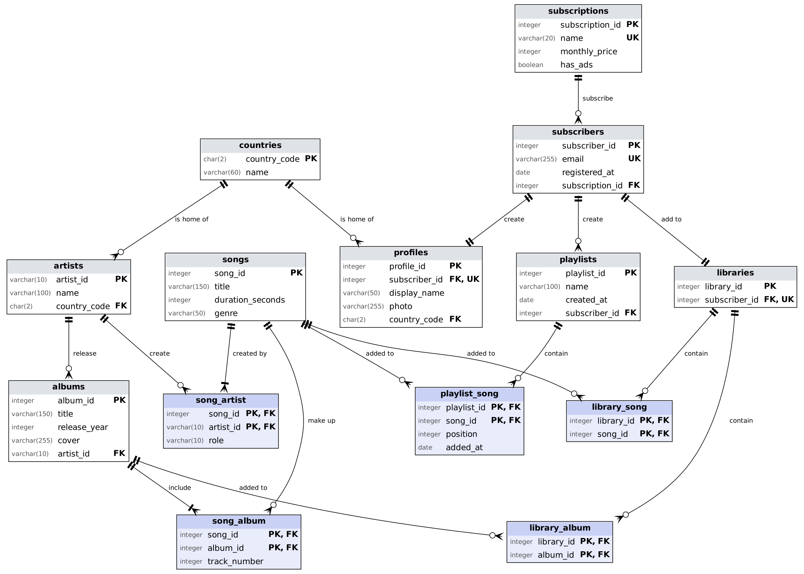

# Tarea 2: Normalización de la BD de Spotify

Kevin Manuel Galván Lara · 2026-11-02

Las cuatro tablas de Laura se normalizan hasta 3FN y producen 12 tablas; solo una entidad es nueva respecto al diagrama conceptual: `countries`.

## Supuestos y convenciones

1. Una canción no se repite dentro de una playlist, así que la llave de `playlist_song` es (playlist_id, song_id). El orden de la celda `canciones` se vuelve la columna `posición` (1, 2, 3…).
2. Una canción aparece una sola vez en un álbum, pero puede estar en varios: TQG (102) está en el álbum 202 (pista 6) y en el 206 (pista 12). La llave de `song_album` es (album_id, song_id).
3. Cada suscriptor tiene un solo plan, y `precio` y `anuncios` dependen del plan, no del suscriptor. Las tablas A y D coinciden: ana es Premium, luis Gratuita, marta Familiar.
4. `email` identifica a un suscriptor (es único).
5. El código de país determina el nombre del país (US → Estados Unidos). Los países de artistas (tabla B) y de suscriptores (tabla D) son el mismo catálogo.
6. Una celda vacía significa "sin datos" y se guarda como vacío (NULL): la foto de marta, la playlist 13 sin canciones, las bibliotecas sin guardados.
7. Una canción puede tener varios artistas y un artista varias canciones (Shakira en 102 y 103). El `rol` es `principal` o `feat.`.
8. Los datos de canciones que aparecen en las tablas A, B y C (título, duración) son consistentes entre sí, así que se unifican en una sola tabla `songs`.
9. `duración` (m:ss) se trata como un solo dato atómico.

**Notación de las tablas:** (PK) = parte de la llave primaria, (FK) = llave foránea. Cuando la llave es compuesta, todas sus columnas llevan (PK).

## Tabla A: playlists

La celda `canciones` guarda una lista con tres datos por canción (id y título con duración, y la fecha en que se agregó), y `suscripción`, `precio` y `anuncios` se repiten en cada playlist del mismo dueño.

### 1FN

Se deja una fila por cada par (playlist, canción) y `canciones` se separa en `song_id`, `título`, `duración`, `posición` y `fecha_agregada`. **Llave primaria: (playlist_id, song_id)**. La playlist 13 está vacía: conserva su fila con los campos de canción vacíos, y esa anomalía desaparece en 2FN.

| playlist_id (PK) | playlist | creada | dueño | suscripción | precio | anuncios | song_id (PK) | título | duración | posición | fecha_agregada |
| --- | --- | --- | --- | --- | --- | --- | --- | --- | --- | --- | --- |
| 10 | Gym | 2026-03-01 | ana@mail.com | Premium | 129 | no | 101 | Ella Baila Sola | 2:45 | 1 | 2026-03-01 |
| 10 | Gym | 2026-03-01 | ana@mail.com | Premium | 129 | no | 102 | TQG | 3:17 | 2 | 2026-03-01 |
| 10 | Gym | 2026-03-01 | ana@mail.com | Premium | 129 | no | 103 | Bzrp Music Sessions #53 | 3:33 | 3 | 2026-03-04 |
| 11 | Para estudiar | 2026-04-10 | ana@mail.com | Premium | 129 | no | 104 | Flowers | 3:20 | 1 | 2026-04-10 |
| 11 | Para estudiar | 2026-04-10 | ana@mail.com | Premium | 129 | no | 101 | Ella Baila Sola | 2:45 | 2 | 2026-04-12 |
| 12 | Gym | 2026-05-02 | luis@mail.com | Gratuita | 0 | sí | 102 | TQG | 3:17 | 1 | 2026-05-02 |
| 12 | Gym | 2026-05-02 | luis@mail.com | Gratuita | 0 | sí | 105 | Kill Bill | 2:33 | 2 | 2026-05-02 |
| 13 | Viaje | 2026-06-15 | marta@mail.com | Familiar | 199 | no | (vacío) | (vacío) | (vacío) | (vacío) | (vacío) |
| 14 | Favoritas | 2026-06-20 | luis@mail.com | Gratuita | 0 | sí | 103 | Bzrp Music Sessions #53 | 3:33 | 1 | 2026-06-20 |
| 14 | Favoritas | 2026-06-20 | luis@mail.com | Gratuita | 0 | sí | 104 | Flowers | 3:20 | 2 | 2026-06-21 |
| 14 | Favoritas | 2026-06-20 | luis@mail.com | Gratuita | 0 | sí | 102 | TQG | 3:17 | 3 | 2026-06-22 |

### 2FN

Dependencias parciales (dependen de una parte de la llave):

- playlist_id → playlist, creada, dueño, suscripción, precio, anuncios
- song_id → título, duración

Dependencia completa: (playlist_id, song_id) → posición, fecha_agregada. Es completa porque la misma canción cambia de posición y de fecha según la playlist: 102 es la posición 2 en la 10 y la 1 en la 12.

Tablas resultantes:

**playlists** (PK: playlist_id)

| playlist_id (PK) | playlist | creada | dueño | suscripción | precio | anuncios |
| --- | --- | --- | --- | --- | --- | --- |
| 10 | Gym | 2026-03-01 | ana@mail.com | Premium | 129 | no |
| 11 | Para estudiar | 2026-04-10 | ana@mail.com | Premium | 129 | no |
| 12 | Gym | 2026-05-02 | luis@mail.com | Gratuita | 0 | sí |
| 13 | Viaje | 2026-06-15 | marta@mail.com | Familiar | 199 | no |
| 14 | Favoritas | 2026-06-20 | luis@mail.com | Gratuita | 0 | sí |

**songs** (PK: song_id), solo con las canciones de esta tabla; la versión completa está en la tabla B

| song_id (PK) | título | duración |
| --- | --- | --- |
| 101 | Ella Baila Sola | 2:45 |
| 102 | TQG | 3:17 |
| 103 | Bzrp Music Sessions #53 | 3:33 |
| 104 | Flowers | 3:20 |
| 105 | Kill Bill | 2:33 |

**playlist_song** (PK: playlist_id + song_id)

| playlist_id (PK) | song_id (PK) | posición | fecha_agregada |
| --- | --- | --- | --- |
| 10 | 101 | 1 | 2026-03-01 |
| 10 | 102 | 2 | 2026-03-01 |
| 10 | 103 | 3 | 2026-03-04 |
| 11 | 104 | 1 | 2026-04-10 |
| 11 | 101 | 2 | 2026-04-12 |
| 12 | 102 | 1 | 2026-05-02 |
| 12 | 105 | 2 | 2026-05-02 |
| 14 | 103 | 1 | 2026-06-20 |
| 14 | 104 | 2 | 2026-06-21 |
| 14 | 102 | 3 | 2026-06-22 |

La playlist 13 queda en `playlists` sin filas en `playlist_song`, así que ya no hay llaves vacías.

### 3FN

Dependencias transitivas en `playlists`:

- playlist_id → dueño → suscripción (el plan lo define el suscriptor, no la playlist)
- playlist_id → suscripción → precio, anuncios (el precio y los anuncios los define el plan)

Se separan el plan y el suscriptor. `songs` y `playlist_song` ya están en 3FN porque ningún atributo no llave determina a otro.

**playlists** (PK: playlist_id, FK: dueño → subscribers.email)

| playlist_id (PK) | playlist | creada | dueño (FK) |
| --- | --- | --- | --- |
| 10 | Gym | 2026-03-01 | ana@mail.com |
| 11 | Para estudiar | 2026-04-10 | ana@mail.com |
| 12 | Gym | 2026-05-02 | luis@mail.com |
| 13 | Viaje | 2026-06-15 | marta@mail.com |
| 14 | Favoritas | 2026-06-20 | luis@mail.com |

**subscriptions** (PK: suscripción), tabla nueva

| suscripción (PK) | precio | anuncios |
| --- | --- | --- |
| Premium | 129 | no |
| Gratuita | 0 | sí |
| Familiar | 199 | no |

El plan de cada dueño (`email → suscripción`) queda en `subscribers`, que se completa con la tabla D. `songs` y `playlist_song` se quedan como en 2FN, con `playlist_song.playlist_id` y `playlist_song.song_id` como llaves foráneas hacia `playlists` y `songs`.

Así, cambiar el precio de Premium se hace en una sola fila y no en cada playlist de cada usuario Premium.

## Tabla B: créditos de canciones

La celda `artistas` guarda varios artistas por canción, cada uno con cuatro datos (id, nombre, país con código y nombre, y rol), y los datos de cada artista se repiten en todas sus canciones.

### 1FN

Se deja una fila por cada par (canción, artista) y `artistas` se separa en `artist_id`, `artista`, `país_código`, `país` y `rol`. El país ("US Estados Unidos") mezclaba dos datos y también se separa. **Llave primaria: (song_id, artist_id)**.

| song_id (PK) | título | duración | género | artist_id (PK) | artista | país_código | país | rol |
| --- | --- | --- | --- | --- | --- | --- | --- | --- |
| 101 | Ella Baila Sola | 2:45 | Regional mexicano | A6 | Eslabon Armado | US | Estados Unidos | principal |
| 101 | Ella Baila Sola | 2:45 | Regional mexicano | A7 | Peso Pluma | MX | México | feat. |
| 102 | TQG | 3:17 | Reguetón | A1 | Karol G | CO | Colombia | principal |
| 102 | TQG | 3:17 | Reguetón | A2 | Shakira | CO | Colombia | feat. |
| 103 | Bzrp Music Sessions #53 | 3:33 | Pop latino | A5 | Bizarrap | AR | Argentina | principal |
| 103 | Bzrp Music Sessions #53 | 3:33 | Pop latino | A2 | Shakira | CO | Colombia | feat. |
| 104 | Flowers | 3:20 | Pop | A3 | Miley Cyrus | US | Estados Unidos | principal |
| 105 | Kill Bill | 2:33 | R&B | A4 | SZA | US | Estados Unidos | principal |
| 106 | Tití Me Preguntó | 4:03 | Reguetón | A8 | Bad Bunny | PR | Puerto Rico | principal |
| 107 | Me Porto Bonito | 2:58 | Reguetón | A8 | Bad Bunny | PR | Puerto Rico | principal |
| 107 | Me Porto Bonito | 2:58 | Reguetón | A9 | Chencho Corleone | PR | Puerto Rico | feat. |
| 108 | Calor de Agosto | 3:05 | Regional mexicano | A10 | Los del Pitic | MX | México | principal |

### 2FN

Dependencias parciales (dependen de una parte de la llave):

- song_id → título, duración, género
- artist_id → artista, país_código, país

Dependencia completa: (song_id, artist_id) → rol, porque el rol es de ese artista en esa canción: Shakira es feat. en 102 y en 103, pero Bad Bunny es principal en 106 y 107.

Tablas resultantes:

**songs** (PK: song_id)

| song_id (PK) | título | duración | género |
| --- | --- | --- | --- |
| 101 | Ella Baila Sola | 2:45 | Regional mexicano |
| 102 | TQG | 3:17 | Reguetón |
| 103 | Bzrp Music Sessions #53 | 3:33 | Pop latino |
| 104 | Flowers | 3:20 | Pop |
| 105 | Kill Bill | 2:33 | R&B |
| 106 | Tití Me Preguntó | 4:03 | Reguetón |
| 107 | Me Porto Bonito | 2:58 | Reguetón |
| 108 | Calor de Agosto | 3:05 | Regional mexicano |

**artists** (PK: artist_id)

| artist_id (PK) | artista | país_código | país |
| --- | --- | --- | --- |
| A1 | Karol G | CO | Colombia |
| A2 | Shakira | CO | Colombia |
| A3 | Miley Cyrus | US | Estados Unidos |
| A4 | SZA | US | Estados Unidos |
| A5 | Bizarrap | AR | Argentina |
| A6 | Eslabon Armado | US | Estados Unidos |
| A7 | Peso Pluma | MX | México |
| A8 | Bad Bunny | PR | Puerto Rico |
| A9 | Chencho Corleone | PR | Puerto Rico |
| A10 | Los del Pitic | MX | México |

**song_artist** (PK: song_id + artist_id)

| song_id (PK) | artist_id (PK) | rol |
| --- | --- | --- |
| 101 | A6 | principal |
| 101 | A7 | feat. |
| 102 | A1 | principal |
| 102 | A2 | feat. |
| 103 | A5 | principal |
| 103 | A2 | feat. |
| 104 | A3 | principal |
| 105 | A4 | principal |
| 106 | A8 | principal |
| 107 | A8 | principal |
| 107 | A9 | feat. |
| 108 | A10 | principal |

### 3FN

Dependencia transitiva en `artists`: artist_id → país_código → país. El nombre del país depende del código, no del artista, y se repite (Colombia dos veces, Estados Unidos tres). Se separa en una **entidad nueva, `countries`**, que también va a servir a los suscriptores de la tabla D.

`songs` no tiene dependencias transitivas. `género` queda como atributo de `songs` y no como entidad: ningún otro atributo depende del género, así que no hay una dependencia que justifique separarlo. `song_artist` tampoco tiene.

**countries** (PK: país_código), tabla nueva

| país_código (PK) | país |
| --- | --- |
| US | Estados Unidos |
| MX | México |
| CO | Colombia |
| AR | Argentina |
| PR | Puerto Rico |

**artists** (PK: artist_id, FK: país_código → countries)

| artist_id (PK) | artista | país_código (FK) |
| --- | --- | --- |
| A1 | Karol G | CO |
| A2 | Shakira | CO |
| A3 | Miley Cyrus | US |
| A4 | SZA | US |
| A5 | Bizarrap | AR |
| A6 | Eslabon Armado | US |
| A7 | Peso Pluma | MX |
| A8 | Bad Bunny | PR |
| A9 | Chencho Corleone | PR |
| A10 | Los del Pitic | MX |

`songs` (8 filas) queda igual que en 2FN. **song_artist** queda igual, con song_id (FK → songs) y artist_id (FK → artists).

## Tabla C: álbumes

La celda `canciones` guarda una lista de pares (número de pista, canción), y `artista` junta el id y el nombre del artista en una sola celda.

### 1FN

Se deja una fila por cada par (álbum, canción); `artista` se separa en `artist_id` y `artista`, y `canciones` en `pista`, `song_id` y `título`. **Llave primaria: (album_id, song_id)**, con el supuesto de que una canción aparece una sola vez por álbum.

| album_id (PK) | álbum | año | portada | artist_id | artista | pista | song_id (PK) | título |
| --- | --- | --- | --- | --- | --- | --- | --- | --- |
| 201 | Desvelado | 2023 | desvelado.jpg | A6 | Eslabon Armado | 6 | 101 | Ella Baila Sola |
| 202 | Mañana Será Bonito | 2023 | msb.jpg | A1 | Karol G | 6 | 102 | TQG |
| 203 | Endless Summer Vacation | 2023 | esv.jpg | A3 | Miley Cyrus | 1 | 104 | Flowers |
| 204 | SOS | 2022 | sos.jpg | A4 | SZA | 2 | 105 | Kill Bill |
| 205 | Un Verano Sin Ti | 2022 | uvst.jpg | A8 | Bad Bunny | 3 | 107 | Me Porto Bonito |
| 205 | Un Verano Sin Ti | 2022 | uvst.jpg | A8 | Bad Bunny | 4 | 106 | Tití Me Preguntó |
| 206 | Las Mujeres Ya No Lloran | 2024 | lmynl.jpg | A2 | Shakira | 11 | 103 | Bzrp Music Sessions #53 |
| 206 | Las Mujeres Ya No Lloran | 2024 | lmynl.jpg | A2 | Shakira | 12 | 102 | TQG |

### 2FN

Dependencias parciales (dependen de una parte de la llave):

- album_id → álbum, año, portada, artist_id, artista
- song_id → título

Dependencia completa: (album_id, song_id) → pista, porque la misma canción tiene distinta pista en cada álbum: TQG es la pista 6 en el 202 y la 12 en el 206. Esto confirma que entre canciones y álbumes hay una relación muchos a muchos.

Tablas resultantes:

**albums** (PK: album_id)

| album_id (PK) | álbum | año | portada | artist_id | artista |
| --- | --- | --- | --- | --- | --- |
| 201 | Desvelado | 2023 | desvelado.jpg | A6 | Eslabon Armado |
| 202 | Mañana Será Bonito | 2023 | msb.jpg | A1 | Karol G |
| 203 | Endless Summer Vacation | 2023 | esv.jpg | A3 | Miley Cyrus |
| 204 | SOS | 2022 | sos.jpg | A4 | SZA |
| 205 | Un Verano Sin Ti | 2022 | uvst.jpg | A8 | Bad Bunny |
| 206 | Las Mujeres Ya No Lloran | 2024 | lmynl.jpg | A2 | Shakira |

**song_album** (PK: album_id + song_id)

| album_id (PK) | song_id (PK) | pista |
| --- | --- | --- |
| 201 | 101 | 6 |
| 202 | 102 | 6 |
| 203 | 104 | 1 |
| 204 | 105 | 2 |
| 205 | 107 | 3 |
| 205 | 106 | 4 |
| 206 | 103 | 11 |
| 206 | 102 | 12 |

La dependencia song_id → título no crea una tabla nueva: `songs` ya existe (tablas A y B) con las 8 canciones y el mismo título para cada `song_id`.

### 3FN

Dependencia transitiva en `albums`: album_id → artist_id → artista. El nombre del artista depende del artista, no del álbum, y ya está en `artists`; en `albums` solo se conserva el `artist_id` como llave foránea.

El álbum guarda su propio `artist_id` y no se deduce de `song_artist`: el álbum 206 es de Shakira, pero sus canciones tienen como artista principal a Bizarrap (103) y a Karol G (102).

**albums** (PK: album_id, FK: artist_id → artists)

| album_id (PK) | álbum | año | portada | artist_id (FK) |
| --- | --- | --- | --- | --- |
| 201 | Desvelado | 2023 | desvelado.jpg | A6 |
| 202 | Mañana Será Bonito | 2023 | msb.jpg | A1 |
| 203 | Endless Summer Vacation | 2023 | esv.jpg | A3 |
| 204 | SOS | 2022 | sos.jpg | A4 |
| 205 | Un Verano Sin Ti | 2022 | uvst.jpg | A8 |
| 206 | Las Mujeres Ya No Lloran | 2024 | lmynl.jpg | A2 |

**song_album** queda igual, con album_id (FK → albums) y song_id (FK → songs). La canción 108 (Calor de Agosto) no está en ningún álbum, así que una canción puede no tener álbum.

## Tabla D: suscriptores

La tabla tiene dos listas dentro de una celda (`canciones_guardadas` y `álbumes_guardados`) y una celda `país` que junta código y nombre. Las celdas vacías son suscriptores sin guardados.

### 1FN

`país` se separa en `país_código` y `país`. Las dos listas son independientes entre sí: lo que alguien guardó como canción no tiene relación con lo que guardó como álbum. Si se aplanaran en una sola tabla (email, song_id, album_id), saldrían combinaciones falsas (luis "guardó la 103 junto con el 204") y la llave tendría valores vacíos (marta, diego). Por eso cada lista pasa a su propia tabla, con una fila por cada valor.

**subscribers** (PK: email)

| email (PK) | registro | suscripción | nombre_visible | foto | país_código | país |
| --- | --- | --- | --- | --- | --- | --- |
| ana@mail.com | 2025-11-02 | Premium | anaruiz | a1.jpg | MX | México |
| luis@mail.com | 2026-01-15 | Gratuita | luis.s | l2.jpg | MX | México |
| marta@mail.com | 2026-05-20 | Familiar | marta_g | (vacío) | AR | Argentina |
| diego@mail.com | 2026-09-01 | Familiar | diegol | d4.jpg | MX | México |

**library_song** (PK: email + song_id)

| email (PK) | song_id (PK) |
| --- | --- |
| ana@mail.com | 102 |
| ana@mail.com | 104 |
| luis@mail.com | 103 |
| diego@mail.com | 101 |
| diego@mail.com | 108 |

**library_album** (PK: email + album_id)

| email (PK) | album_id (PK) |
| --- | --- |
| ana@mail.com | 205 |
| luis@mail.com | 204 |
| luis@mail.com | 206 |

Marta no tiene filas en ninguna de las dos, y diego no tiene álbumes guardados.

### 2FN

No hay dependencias parciales. `subscribers` tiene una llave de una sola columna (email), así que todos sus atributos dependen de la llave completa. `library_song` y `library_album` tienen llave compuesta pero ningún atributo fuera de ella, así que no hay nada que dependa de solo una parte. Las tres tablas ya están en 2FN y no cambian.

### 3FN

Dependencias transitivas en `subscribers`:

- email → país_código → país (el nombre del país depende del código; "México" se repite tres veces)
- email → suscripción → precio, anuncios (ya resuelta en la tabla A con `subscriptions`)

El país sale a `countries`, la misma tabla que surgió en la tabla B, a la que no hay que añadirle nada: MX y AR ya estaban ahí por los artistas. `subscribers` conserva `suscripción` y `país_código` como llaves foráneas.

**subscribers** (PK: email, FK: suscripción → subscriptions, país_código → countries)

| email (PK) | registro | suscripción (FK) | nombre_visible | foto | país_código (FK) |
| --- | --- | --- | --- | --- | --- |
| ana@mail.com | 2025-11-02 | Premium | anaruiz | a1.jpg | MX |
| luis@mail.com | 2026-01-15 | Gratuita | luis.s | l2.jpg | MX |
| marta@mail.com | 2026-05-20 | Familiar | marta_g | (vacío) | AR |
| diego@mail.com | 2026-09-01 | Familiar | diegol | d4.jpg | MX |

**library_song** queda igual, con email (FK → subscribers) y song_id (FK → songs). **library_album** queda igual, con email (FK → subscribers) y album_id (FK → albums).

Los datos de esta tabla no obligan a crear `profiles` ni `libraries`: `nombre_visible`, `foto`, `país_código` y las dos listas guardadas dependen directamente de `email`, igual que `registro`. Esas dos entidades del diagrama conceptual no surgen de la normalización; se conservan en el diagrama ER como relaciones uno a uno con `subscribers` (ver el diagrama final).

## Esquema final en 3FN

Las cuatro tablas de Laura se convierten en 12 tablas en 3FN. Todas las del diagrama conceptual aparecen, salvo `profiles` y `libraries`, y surge una entidad nueva.

| Tabla en 3FN | Llave primaria | Llaves foráneas | Viene de | En el diagrama conceptual |
| --- | --- | --- | --- | --- |
| subscriptions | suscripción | — | A | Sí |
| subscribers | email | suscripción → subscriptions; país_código → countries | A, D | Sí |
| countries | país_código | — | B, D | **Nueva** |
| songs | song_id | — | A, B, C | Sí |
| artists | artist_id | país_código → countries | B, C | Sí |
| albums | album_id | artist_id → artists | C | Sí |
| playlists | playlist_id | dueño → subscribers | A | Sí |
| playlist_song | playlist_id + song_id | playlist_id → playlists; song_id → songs | A | Sí |
| song_artist | song_id + artist_id | song_id → songs; artist_id → artists | B | Sí |
| song_album | album_id + song_id | album_id → albums; song_id → songs | C | Sí |
| library_song | email + song_id | email → subscribers; song_id → songs | D | Sí |
| library_album | email + album_id | email → subscribers; album_id → albums | D | Sí |

Diferencias con el diagrama conceptual:

- **Entidad nueva: `countries`.** Se justifica con la dependencia país_código → país, que aparece en artistas (tabla B) y en suscriptores (tabla D). Agrega dos relaciones: un país tiene muchos artistas y un país tiene muchos perfiles.
- **`profiles` y `libraries` no surgen al normalizar.** Sus atributos dependen directamente de `email`, sin dependencia que obligue a separarlos. Se conservan en el ER como relaciones uno a uno con `subscribers`, tal como las dibujó el diagrama conceptual.
- **No cambia nada más:** las cinco tablas de unión y las cuatro entidades restantes aparecen tal cual en el diagrama.

## Diagrama ER

El diagrama tiene 14 entidades: las 12 tablas en 3FN más `profiles` y `libraries` del diagrama conceptual. Las tablas de unión van en azul y la entidad nueva, `countries`, está arriba a la izquierda. En cada extremo, la marca más cercana a la entidad indica el máximo (barra = 1, pata de gallo = muchos) y la más lejana el mínimo (círculo = 0, barra = 1).

### Cardinalidades

La cantidad de cada entidad se lee "por cada" una de la otra: por ejemplo, por cada plan hay de 0 a N suscriptores (mínimo 0, máximo N), y por cada suscriptor hay exactamente 1 plan.

| Entidad A | A por cada B (mín..máx) | Verbo | Entidad B | B por cada A (mín..máx) |
| --- | --- | --- | --- | --- |
| subscriptions | 1..1 | subscribe | subscribers | 0..N |
| subscribers | 1..1 | create | profiles | 1..1 |
| subscribers | 1..1 | add to | libraries | 1..1 |
| subscribers | 1..1 | create | playlists | 0..N |
| countries | 1..1 | is home of | profiles | 0..N |
| countries | 1..1 | is home of | artists | 0..N |
| playlists | 1..1 | contain | playlist_song | 0..N |
| songs | 1..1 | added to | playlist_song | 0..N |
| libraries | 1..1 | contain | library_song | 0..N |
| songs | 1..1 | added to | library_song | 0..N |
| libraries | 1..1 | contain | library_album | 0..N |
| albums | 1..1 | added to | library_album | 0..N |
| songs | 1..1 | make up | song_album | 0..N |
| albums | 1..1 | include | song_album | 1..N |
| songs | 1..1 | created by | song_artist | 1..N |
| artists | 1..1 | create | song_artist | 0..N |
| artists | 1..1 | release | albums | 0..N |

Los datos de Laura respaldan los mínimos: la playlist 13 no tiene canciones (0), la canción 108 no está en ningún álbum (0), marta no tiene nada guardado (0), y toda canción tiene al menos un artista y todo álbum al menos una canción (1).

### Decisiones de diseño del diagrama

- **Llaves sustitutas.** En la normalización las llaves eran `email` y `suscripción`. En el ER se usan `subscriber_id` y `subscription_id` como PK, y `email` y `name` quedan como únicos (UK). Así las llaves foráneas son enteros y no textos. `profiles` y `libraries` tienen su propio id y un `subscriber_id` único, lo que fuerza la relación uno a uno.
- **`artist_id` conserva los ids de Laura** (A1 a A10) como `varchar(10)`; el resto de los ids son enteros, como vienen en sus tablas.
- **Nombres y tipos.** `duración` (m:ss) pasa a `duration_seconds` (2:45 = 165), `año` a `release_year`, `pista` a `track_number`, `posición` a `position` y `portada` a `cover`. Los tipos son una propuesta razonable para PostgreSQL, no vienen en los datos.
- **País en `profiles`.** Se colocó `country_code` junto a `display_name` y `photo`, porque así vienen agrupadas en la tabla D. `profiles.photo` admite vacío (la foto de marta); `role` solo toma los valores `principal` y `feat.`.
- **Las tablas de unión** `library_song` y `library_album` usan `library_id` en vez de `email`, porque la biblioteca es ahora su propia entidad.
